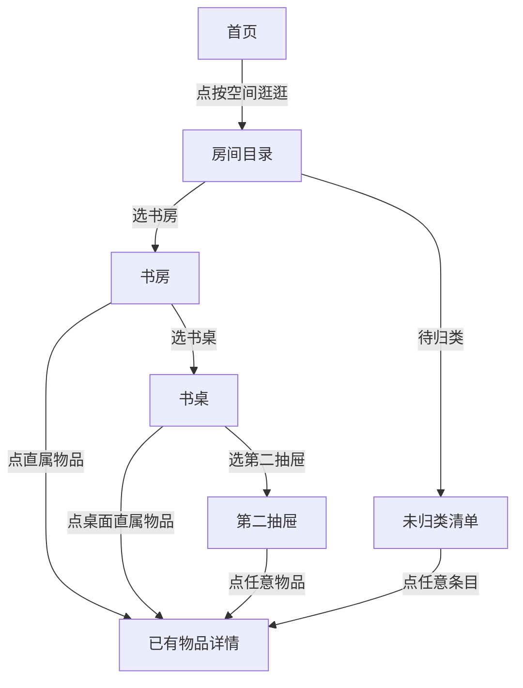

# Issue #15｜家庭空间树 v0 — 设计交付说明（PM / 前端对照用）

> **Design-only / 不得直接生产实现。** 原型只是一个可点击的产品设计候选，不对现有 `itemsApi` 或数据库构成变更授权。验收优先级：Issue #15 的事实合同 > 本文交互状态 > 四屏视觉图。视觉与安全合同冲突时提出评审，不自行猜测。

## 交付物：不要只读文字

1. **[四屏高保真视觉图](location-tree-v0-screens.svg)**：可直接在 GitHub 预览。S1（首页入口）、S2（房间总览）、S3（书房子空间+直属物品）、S4（抽屉物品）。
2. **[可点击 HTML 单文件原型](location-tree-v0-prototype.html)**：下载 Raw HTML，用浏览器打开。可从首页点击「按空间逛逛」，逐层进入书房→书桌→第二抽屉，再点击物品；另可体验「未归类」「返回/面包屑」「搜索示意」。不连接麦克风、数据库或 AI，**不会上传或保存任何实际数据**。
3. **[Issue #15](https://github.com/DeepDreamerLSC/home-memory/issues/15)**：任务、分阶段验证及数据合同。视觉稿是 D0 验收基准，不是正式版本设计代码。

## 现有产品基线

- 以已合并 [PR #9](https://github.com/DeepDreamerLSC/home-memory/pull/9) 为 UI 基线：系统深浅色、奶油白 `#FAF8F2`、明黄 `#FFE15A`、墨黑 `#191919`、黑方块物品首字图标、圆角触点。
- 原始首页「搜索在上、黄色语音区为录入焦点、最近记录」保持；S1 仅在搜索下增加一个可点击的**次级**「按空间逛逛」入口。
- 如后续按 Issue #3 增加「拍照／视频批量记」，与空间入口并列在各自语义组内；**不要因为本原型未画照相入口，就删除或阻断 Issue #3 的计划**。
- 原型的「书房、小冰箱、抽屉、24 件」都是**示意**，不得写死成产品数据，也不得称已经从数据库读取。

## 四屏布局/视觉还原核对表

| 屏幕 | 首屏关键布局 | 点击反馈 | PM 必须留存截图 |
|---|---|---|---|
| S1 首页入口 | 品牌头→搜索→白底灰色图标「按空间逛逛」→白卡黄录音触点→最近记录。空间入口整行点击，视觉不能超过黄色录音触点 | 点击到 S2；录音/搜索仍按当前 PR #9 原路径 | 首页未打开树/打开后返回一致 |
| S2 空间首页 | 导航返回→“按房间翻翻”→房间卡（名称/子空间示例/子孙物品数）→**尚未归类**→上次记录提示 | 点“书房”进入 S3；未归类展示原位置含糊项，不冒充新建房间 | 正常+全部未归类+零房间 |
| S3 书房 | 可点击面包屑→书房（12 件是子孙去重数）→**往里看看**（书桌8/小冰箱3）→**直接记录在书房**（1 件） | 点书桌进入同构子空间页；点直属物品进入既有详情 | 既有子空间、仅直属、仅子节点三态 |
| S4 右侧第二抽屉 | 完整位置语境+“5件”→「这里只展示上次确认位置」提示→真实条目卡（首字/名称/上次完整位置/箭头） | 每行进入物品详情；按返回回到父节点，面包屑可快速跳层 | 叶子空间有物品/空位置 |

### UI 尺寸 / 字色（用于还原，不是生产硬编码）

- 视觉参考移动端宽度约 334–390 逻辑像素；横向内容边距参考 18–20px、卡片圆角 15–20px、行内触点整体高度 **至少 44px**，推荐目录卡 75–95px。
- 一级标题约 26–29px，房间/条目名称约 15–17px，辅助信息约 11–13px；辅助文字必须兼顾对比度与字体放大，不用低对比色表达关键位置。
- yellow / brand 只作为声录入口主要高对比面；「按空间逛逛」走白卡、墨色图标及箭头，不和录音主 CTA 抢眼。
- S2 房间「X 件」=该节点 + 后代**去重后**的 Item ID 数。S3 书房 12 = 书桌8 + 小冰箱3 + 直属1。S4 抽屉5属于书桌8的**子集**。
- 暗色主题不得沿用浅色灰文字；在真机对照 PR #9 的当前 @media + theme.json，检查导航栏/胶囊/输入框均可读。SVG 示意为浅色主题，HTML 预览可跟随系统深浅色。

## 交互状态与精确定义



- 目录页：「子空间」与「直接属于本位置的物品」**不能混在一起，也不能漏显示直属项**。
- 不允许根据名称自动合并：`书房/右侧第二个抽屉` 与 `卧室/右侧第二个抽屉` 是独立节点；`书房/白柜` 与 `书房/浅色柜子` 只有人工或高可信确认后才可映射。
- 「未归类」是**正常可见状态**：不确定的 `location_text` 必须可通过原文查看/搜索找到；不能强迫 AI 把它填进房间。
- 真实 Item 仍含既有 `location_text`；它不是 GPS 当前实时位置，界面统一显示「上次记录」。
- 层级深时面包屑允许横向滚动/折叠，返回父节点始终可用；避免挤压标题和 44px 点击区域。
- V0 人审候选树可以按相似 `candidate_path` 分组；这个结果不可静默回写 Item，不对其他家庭开放。

## PM 验收案例（需要截图/视频或可复现记录）

1. 首页进入空间树后返回，不影响已有搜索、语音触控和文字回退。
2. 书房 12 件 = 书桌8 + 冰箱3 + 直属1；抽屉5只算入书桌8一次；所有节点件数从唯一 Item ID 计算。
3. 房间有 1 件直属物品且有子空间时，两个区块均存在。
4. 只有直属物品 / 只有下级空间 / 空目录：有对应提示，不出现假空态。
5. 两个同名抽屉分别属于不同父节点时，点击进入不同列表。
6. 位置只写“那个柜子里”的物品仍可在「待归类」看到原文，不凭空补房间。
7. 同一个物品不因为父子层重复出现而增加计数或被多次返回。
8. 网络失败、慢加载时有真实提示，不显示旧目录为最新。
9. iOS/Android、系统深浅色、窄屏/大字体、顶部安全区、触摸目标有明确验收截图。
10. 实验 V0 只读：不存在任何 create/move/delete Item；与正式 API/数据 schema 的变更数为零。

## 交付/开发授权说明

当前只允许完成 D0 视觉评审与 V0 虚拟目录实验。**不要直接把 HTML 复制到小程序里发布**；生产小程序仍使用 TS/WXML/WXSS，并复用现有可信数据层。是否落地持久化 `LocationNode`、是否将“房间”设强制字段，需要 V0 数据和单独人审的架构方案决定。
---

# v0.1 增补｜空间 / 家具 / 物品编辑 + 语音指令（2026-10-10）

> 这部分是 **D0 交互设计追加**，不是 V1 正式读写能力的授权。此前“V0 只读”指正式 `Item` 和正式 `LocationNode` 不能被实验修改；当前 HTML 可以对**模拟 fixture** 进行交互预览，不连接真实持久化 API。

## 新增设计资产

- **[E1–E4 编辑四屏高保真视觉稿](location-tree-v0-edit-screens.svg)**：E1 书房编辑态、E2 新增位置与 AI 回填、E3 移动单件物品（前后位置对比）、E4 语音编辑草稿核对。
- **[统一可点击 HTML 原型](location-tree-v0-prototype.html)**：原本 S1–S4 浏览路径保留；新增 `书房 → 编辑`、`房间目录 → +房间`、`编辑空间 → +新增/修改/移动/语音编辑` 的可点分支。
- **[Issue #15](https://github.com/DeepDreamerLSC/home-memory/issues/15)**：以下交互/数据/安全门写回需求记录。

## E1–E4 页面映射（UI 必须按图核对）

| 画面 | 用户可操作控件 | 行为/反馈 | 状态属性 |
|---|---|---|---|
| E1 房间编辑 | 右上角「编辑/完成」入口；家具卡「修改」；直属物品「移动」；「+新增」；底部语音操作 CTA | 房间浏览切入编辑，操作对象清楚；无删除或批量移动的危险快捷键 | edit / idle，模拟编辑 |
| E2 新增位置 | 上级位置选择、`房间/家具/抽屉` 类型、名称输入、语音转写描述、AI 填充预览、确认新增 | 自然语言填充只是草稿；房间/柜子/抽屉可以编辑；重复候选需选择复用或新建 | unparsed / parsed / ambiguous / confirmed（模拟） |
| E3 移动单件物品 | 物品选择（同名给辨识信息）、原位置（只读）、目标位置选择、影响范围、确认 | 同名的充电宝必须选具体记录；仅移动 1 件，不影响家具及兄弟物品 | candidate / choice-needed / confirm（模拟） |
| E4 语音编辑 | 语音转写文本可编辑、解析指令、AI 意图卡（操作+对象+前后位置）、取消/继续核对 | 转写修改后旧解析失效；含糊位置/多匹配无法直接执行；继续核对转 E3 具体 Item 选择 | transcribed / needs-parse / draft / ambiguous / confirmed（模拟） |

### 两条典型端到端路径

```text
路径 A · 手动编辑
按空间逛逛 → 书房 → 编辑
  → 添加家具 / 修改柜子名称 / 对直属物品点移动
  → 查看变化范围 + 确认（V0 只演示、不入库）
```

```text
路径 B · 语音编辑
按空间逛逛 → 书房 → 编辑 → 说一句，帮我修改
  → 录音转写（HTML 原型为输入框）
  → AI 意图草稿（HTML 原型固定示例，不真的调用模型）
  → 选择具体物品 + 核对原位置与新位置
  → 二次确认（V0 只演示、不入库）
```

## 三类编辑意图必须分别建模

**Ⅰ. 改名 `rename_location`**：只更改被选中的空间节点显示名称。展示后代数量、当前引用数量；**不自动重写用户确认过的历史 `location_text`**。正式语义、显示路径同步与版本策略需 V1 ADR 决定。

**Ⅱ. 移动单件 `move_item`**：明确单个 Item ID、原位置、目标 Location ID，并保存用户确认的新 `location_text`。正式写入复用服务端授权、版本与幂等机制；在确认前重取版本/位置，防止其他成员的较新修改被覆盖；不单靠物品名称定位。

**Ⅲ. 新增位置 `create_location`**：识别用户自定义名字、节点类型、父节点。系统先查询同父节点已有候选，防止“白柜/浅色柜子”误拆、不同父节点同名误并；**AI 不得擅自合并**。确认后才构建节点，V0 只留候选。

**家具 ≠ 必须有一个独立 Item**：桌子、冰箱、沙发可以作为 LocationNode 的收纳容器。只有需要维护、提醒或独立追踪时，才另关联 Item；避免自动创建双份“书桌”。

## AI 输出仅是可检验的结构化建议

建议实验草稿形状（**不等于生产 API schema**）：

```json
{
  "intent": "move_item",
  "raw_transcript": "把充电宝移到客厅电视柜里",
  "target_item_candidates": [
    {"item_id": "item_a", "name": "充电宝", "last_location": "书房第二个抽屉"},
    {"item_id": "item_b", "name": "充电宝", "last_location": "玄关收纳盒"}
  ],
  "destination_path_candidate": ["客厅", "电视柜"],
  "resolved_item_id": null,
  "confirmed": false
}
```

- `resolved_item_id=null` 表示**歧义未消除，确认按钮不得执行**。
- 位置/对象候选必须经过读取**当前可信范围**的确定性匹配；模型输出的 ID/用户前端传来的 household ID 不构成授权。
- “书桌搬到卧室”是 `move_subtree`，**不可**借 `move_item` 的单件确认界面偷偷移动一整棵树；V2 才评审影响计数、循环防护、更新方式和回滚。
- 删除/合并含子节点的空间属于破坏性操作，不进入本次 D0/V0 的可写范围。
- 编辑语音转写后必须清空旧模型解释；语音失败/识别为空要保留文字手动入口；异步回调在退出/换页后不得执行旧修改。
- 对本地 UI 可通过生成固定示例 fixture 模拟意图识别，但**必须标示“固定演示”**，不能暗示真的接通 ASR 或 AI。

## 编辑扩展验收案例（与前面 S1–S4 的 10 项并列）

1. 首页搜索、黄色语音入口、最近记录没有因添加空间编辑而退化；浏览和编辑状态有明显区分。
2. E1 中从“书房→编辑”进入，能分别找到「新增家具/位置」「修改家具」「移动直属物品」「语音修改」入口，全部至少 44px 热区。
3. E2 可选“我的家”新建房间，也可在书房下建家具，在书桌下建抽屉；不能形成孩子级别的“整个家庭”；上级选错能改。
4. E2 使用“书房有一个靠窗的白柜”得到**候选而非已新建**，用户可以改名、改父节点；歧义/同名要显式确认。
5. E3 至少两件同名“充电宝”能显示为不同 ID/不同上次记录位置，不能自动选中不确定对象；一个确认仅更新一件。
6. E4 转写可编辑。转写文本被修改之后，旧解析状态失效；重新解析之前，确认动作禁用/拒绝。
7. E4 不支持的指令不能生成“成功”的 UI 或调用真实修改；只能提示需要人工核对。
8. 正式模型出错、用户取消、退回、超时后零数据修改；V0 原型明确说明所有确认都不会写库。
9. 预览树移动/改名必须展示受影响的物品件数；重命名不会悄悄重写原始 `location_text`。
10. V0 仍不引入生产 schema/云函数修改；V1 权限/并发/幂等/家庭隔离另过人审。

## 分期更新

- **D0（本 PR）**：将原四屏浏览 SVG 扩展为“浏览四屏 + 编辑四屏”两张并列视觉稿，并在**同一个原型**中串起浏览/编辑/语音模拟流程。
- **V0（下一阶段，仅实验）**：20–30 件金标记录形成只读树，同时做**编辑操作的离线模拟/可用性观察**，检查房间名称纠错、移动单件、同名选择、用户是否理解语音意图预览；生产事实零改动。
- **V1（须另授权）**：正式节点读写合同评审后，才逐步开放新增/改名位置与单件物品移动。
- **V2（再审）**：子树移动、节点合并、删除含物品的空间；不与 V1 打包。

**设计验收完成 ≠ 交互代码可合并 ≠ 生产修改获授权。**
