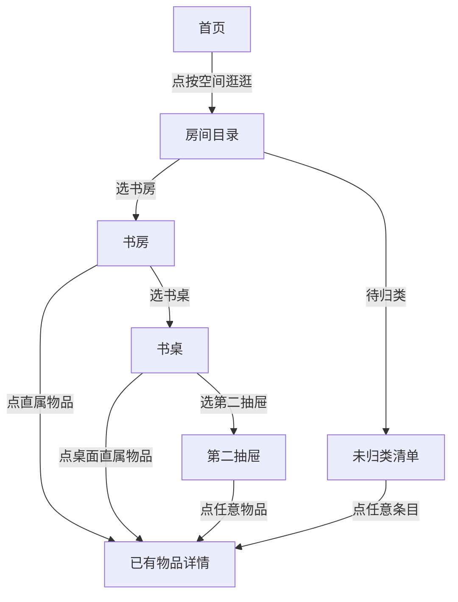

# Issue #15｜家庭空间树 v0 — 设计交付说明（PM / 前端对照用）

> **Design-only / 不得直接生产实现。** 原型只是一个可点击的产品设计候选，不对现有 `itemsApi` 或数据库构成变更授权。验收优先级：Issue #15 的事实合同 > 本文交互状态 > 四屏视觉图。视觉与安全合同冲突时提出评审，不自行猜测。

## 交付物：不要只读文字

1. **[四屏高保真视觉图](location-tree-v0-screens.svg)**：可直接在 GitHub 预览。S1（首页入口）、S2（房间总览）、S3（书房子空间+直属物品）、S4（抽屉物品）。
2. **[可点击 HTML 单文件原型](location-tree-v0-prototype.html)**：下载 Raw HTML，用浏览器打开。可从首页点击「按空间逛逛」，逐层进入书房→书桌→第二抽屉，再点击物品；另可体验「未归类」「返回/面包屑」「搜索示意」。不连接麦克风、数据库或 AI，**不会上传或保存任何实际数据**。
3. **[Issue #15](https://github.com/DeepDreamerLSC/home-memory/issues/15)**：任务、分阶段验证及数据合同。视觉稿是 D0 验收基准，不是正式版本设计代码。

## 现有产品基线

- 以已合并 [PR #9](https://github.com/DeepDreamerLSC/home-memory/pull/9) 为 UI 基线：系统深浅色、奶油白 `#FAF8F2`、明黄 `#FFE15A`、墨黑 `#191919`、黑方块物品首字图标、圆角触点。
- 原始首页「搜索在上、黄色语音区为录入焦点、最近记录」保持；S1 仅在搜索下增加一个可点击的**次级**「按空间逛逛」入口。
- 如后续按 Issue #3 增加「拍照／视频批量记」，与空间入口并列在各自语义组内；**不要因为本原型未画照相入口，就删除或阻断 Issue #3 的计划**。
- 原型的「书房、小冰箱、抽屉、24 件」都是**示意**，不得写死成产品数据，也不得称已经从数据库读取。

## 四屏布局/视觉还原核对表

| 屏幕 | 首屏关键布局 | 点击反馈 | PM 必须留存截图 |
|---|---|---|---|
| S1 首页入口 | 品牌头→搜索→白底灰色图标「按空间逛逛」→白卡黄录音触点→最近记录。空间入口整行点击，视觉不能超过黄色录音触点 | 点击到 S2；录音/搜索仍按当前 PR #9 原路径 | 首页未打开树/打开后返回一致 |
| S2 空间首页 | 导航返回→“按房间翻翻”→房间卡（名称/子空间示例/子孙物品数）→**尚未归类**→上次记录提示 | 点“书房”进入 S3；未归类展示原位置含糊项，不冒充新建房间 | 正常+全部未归类+零房间 |
| S3 书房 | 可点击面包屑→书房（12 件是子孙去重数）→**往里看看**（书桌8/小冰箱3）→**直接记录在书房**（1 件） | 点书桌进入同构子空间页；点直属物品进入既有详情 | 既有子空间、仅直属、仅子节点三态 |
| S4 右侧第二抽屉 | 完整位置语境+“5件”→「这里只展示上次确认位置」提示→真实条目卡（首字/名称/上次完整位置/箭头） | 每行进入物品详情；按返回回到父节点，面包屑可快速跳层 | 叶子空间有物品/空位置 |

### UI 尺寸 / 字色（用于还原，不是生产硬编码）

- 视觉参考移动端宽度约 334–390 逻辑像素；横向内容边距参考 18–20px、卡片圆角 15–20px、行内触点整体高度 **至少 44px**，推荐目录卡 75–95px。
- 一级标题约 26–29px，房间/条目名称约 15–17px，辅助信息约 11–13px；辅助文字必须兼顾对比度与字体放大，不用低对比色表达关键位置。
- yellow / brand 只作为声录入口主要高对比面；「按空间逛逛」走白卡、墨色图标及箭头，不和录音主 CTA 抢眼。
- S2 房间「X 件」=该节点 + 后代**去重后**的 Item ID 数。S3 书房 12 = 书桌8 + 小冰箱3 + 直属1。S4 抽屉5属于书桌8的**子集**。
- 暗色主题不得沿用浅色灰文字；在真机对照 PR #9 的当前 @media + theme.json，检查导航栏/胶囊/输入框均可读。SVG 示意为浅色主题，HTML 预览可跟随系统深浅色。

## 交互状态与精确定义

- 目录页：「子空间」与「直接属于本位置的物品」**不能混在一起，也不能漏显示直属项**。
- 不允许根据名称自动合并：`书房/右侧第二个抽屉` 与 `卧室/右侧第二个抽屉` 是独立节点；`书房/白柜` 与 `书房/浅色柜子` 只有人工或高可信确认后才可映射。
- 「未归类」是**正常可见状态**：不确定的 `location_text` 必须可通过原文查看/搜索找到；不能强迫 AI 把它填进房间。
- 真实 Item 仍含既有 `location_text`；它不是 GPS 当前实时位置，界面统一显示「上次记录」。
- 层级深时面包屑允许横向滚动/折叠，返回父节点始终可用；避免挤压标题和 44px 点击区域。
- V0 人审候选树可以按相似 `candidate_path` 分组；这个结果不可静默回写 Item，不对其他家庭开放。

## PM 验收案例（需要截图/视频或可复现记录）

1. 首页进入空间树后返回，不影响已有搜索、语音触控和文字回退。
2. 书房 12 件 = 书桌8 + 冰箱3 + 直属1；抽屉5只算入书桌8一次；所有节点件数从唯一 Item ID 计算。
3. 房间有 1 件直属物品且有子空间时，两个区块均存在。
4. 只有直属物品 / 只有下级空间 / 空目录：有对应提示，不出现假空态。
5. 两个同名抽屉分别属于不同父节点时，点击进入不同列表。
6. 位置只写“那个柜子里”的物品仍可在「待归类」看到原文，不凭空补房间。
7. 同一个物品不因为父子层重复出现而增加计数或被多次返回。
8. 网络失败、慢加载时有真实提示，不显示旧目录为最新。
9. iOS/Android、系统深浅色、窄屏/大字体、顶部安全区、触摸目标有明确验收截图。
10. 实验 V0 只读：不存在任何 create/move/delete Item；与正式 API/数据 schema 的变更数为零。

## 交付/开发授权说明

当前只允许完成 D0 视觉评审与 V0 虚拟目录实验。**不要直接把 HTML 复制到小程序里发布**；生产小程序仍使用 TS/WXML/WXSS，并复用现有可信数据层。是否落地持久化 `LocationNode`、是否将“房间”设强制字段，需要 V0 数据和单独人审的架构方案决定。