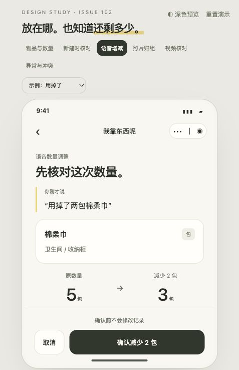

# 轻量数量管理 UI 提案

2026-10-23，依据 [issue #102](https://github.com/DeepDreamerLSC/home-memory/issues/102) 与关联 [issue #101](https://github.com/DeepDreamerLSC/home-memory/issues/101)。状态：**设计提案，待用户审阅**。本次仅新增独立 HTML 原型及设计说明，不改小程序、API、数据结构或云环境。

预览：http://127.0.0.1:8766/quantity-v1/ 。以 `docs/design` 为根目录提供静态服务即可运行；同目录两张 PNG 为现有物品插画的复用副本，照片和视频画面为 SVG 示例，不代表真实识别。

## 设计依据

延续根目录 `DESIGN.md` 的 Visual language / Content voice：奶油底色、深绿主操作、轻描边卡片、简洁中文、主题语义色。数量嵌入现有录入、物品和核对流程，不增加独立库存首页。

## 六个查看入口

| 场景 | 主交互 | 关键约束 |
| --- | --- | --- |
| 物品与数量 | 列表看数量，详情点击修改 | 数量标为上次确认；0 保留物品；旧行明确待核对 |
| 新建时核对 | 语音预填，数量步进器与单位选择，核对后保存 | 新建 1–9999；已有同类仅提供新建/修改选择，不自动叠加 |
| 语音增减 | 原话、目标位置、原数量→变化→结果，确认后更新示例 | 同名目标需选择；不同单位拦截；旧数量先核对；跨位置部分移动提示不支持 |
| 照片归组 | 选择来源候选，选择一条总数或两条独立记录 | 用户主动确认；两个不同框合成后采用整图留证 |
| 视频核对 | 默认折叠候选组，展开原始线索，确认件数或拆分来源 | 线索数与数量独立；所有来源保留；不自动判同一实物 |
| 异常与冲突 | 刷新后再确认、未知结果人工核对、归零/数量不足示例 | 冲突不套用旧变化；结果未知不自动重复扣减 |

页面外的下拉框用于切换语音与异常示例，不属于正式小程序的产品界面。深色按钮只改变本原型，不影响已保存的个人主题。

## 具体交互决定

1. 列表使用“3 条记录”，不将 item 数、实物数量和候选线索数相加；数量在右侧显示，单位紧随。旧记录显示“待核对”。
2. 详情使用“上次确认数量”，带确认时间。旧备注折叠为原备注，不能解析为库存；即便包含“×3 / 500ml”，数量仍未知。原备注不改写、不同时放在主数量旁。
3. 详情修改是“设为当前总数”，不暗示加减；可填0，并说明物品、位置、提醒、证据保留。改变单位需重新核对总数，不做换算。
4. 语音确认优先展示比较结果，减少、增加、设为总数三个模式明确分开；转写和候选匹配在原型中使用预设示例，不连接麦克风或模型。修改模式后继续保留原话供核对。
5. 模糊目标不默认选中。同名不同单位的例子中，“包”不能直接加到“盒”；选择不匹配目标会禁止确认。
6. 版本冲突先显示最新值，例如原5、家人更新为7；点击查看后才重新进入7→5核对，不直接写入。结果不明且有后续修改时，引导核对当前实物总数，不能盲重放扣减。
7. 视觉归组区分“合成一条，记录总数”和“分成两条，各自记录”。前者适用于同类、同位置、同单位且可互换的物品；不合并已经入库的 item。
8. 视频原型用6条线索演示两种模式：确认这些来源属于一条记录并自行填写总数；或把每条来源明确分给A/B两条物品。整组来源确认可一次操作，来源默认不勾选，不强迫逐帧点六次。

## 仍需后续设计 / 实施验收

- 原型用2个照片候选、6条视频线索、拆成A/B两条演示；任意N条、部分来源待核对、手动补件、跨组分配、撤销与会话恢复，实施前需补齐共同状态合同。当前原型不声称已覆盖所有组合。
- 来源帧需要在真实产品里可点开带原图与候选框的预览；本原型的SVG画面仅说明信息层级，不用它评价识别能力。
- 单物品最多8段高亮；超过上限时保留全部来源线索供核对，并显式说明实际保存的高亮数。不能静默丢弃来源。
- 共享家庭切换、目标删除、单位调整语义、旧客户端兼容及CAS/幂等由Q0冻结；原型不实现后端协议或弱网重试。
- 不引入低库存提示、采购/补货推送、库存流水、条码、自动扣减或跨位置部分数量搬移。
- Q1、Q2、Q3页面体现完整目标体验，分别实施仍须按issue独立授权；原型不代表这些能力已经上线。

## 验证

浏览器查看浅色、深色与窄屏布局；走查数量确认、候选合成、视频拆分来源校验、冲突重确认及单位不匹配禁止确认。语音确认截图随本目录归档；完整本地走查证据存于 `.omx/artifacts/quantity-v1/`，视觉检查为93分通过。所有变化仅存在浏览器内存，刷新重置，无网络写入。
